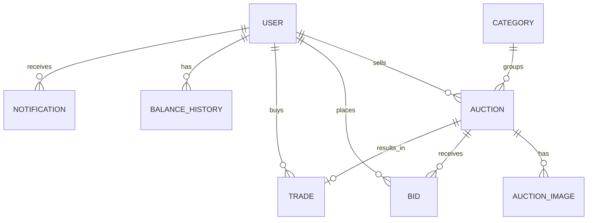
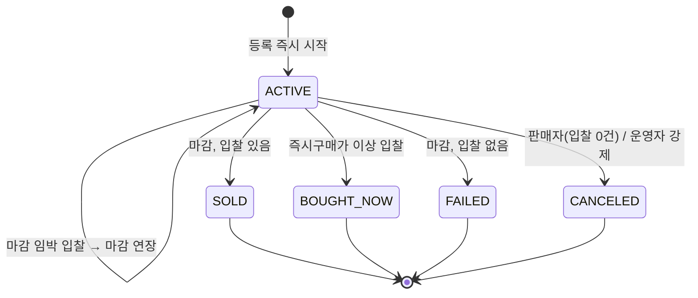
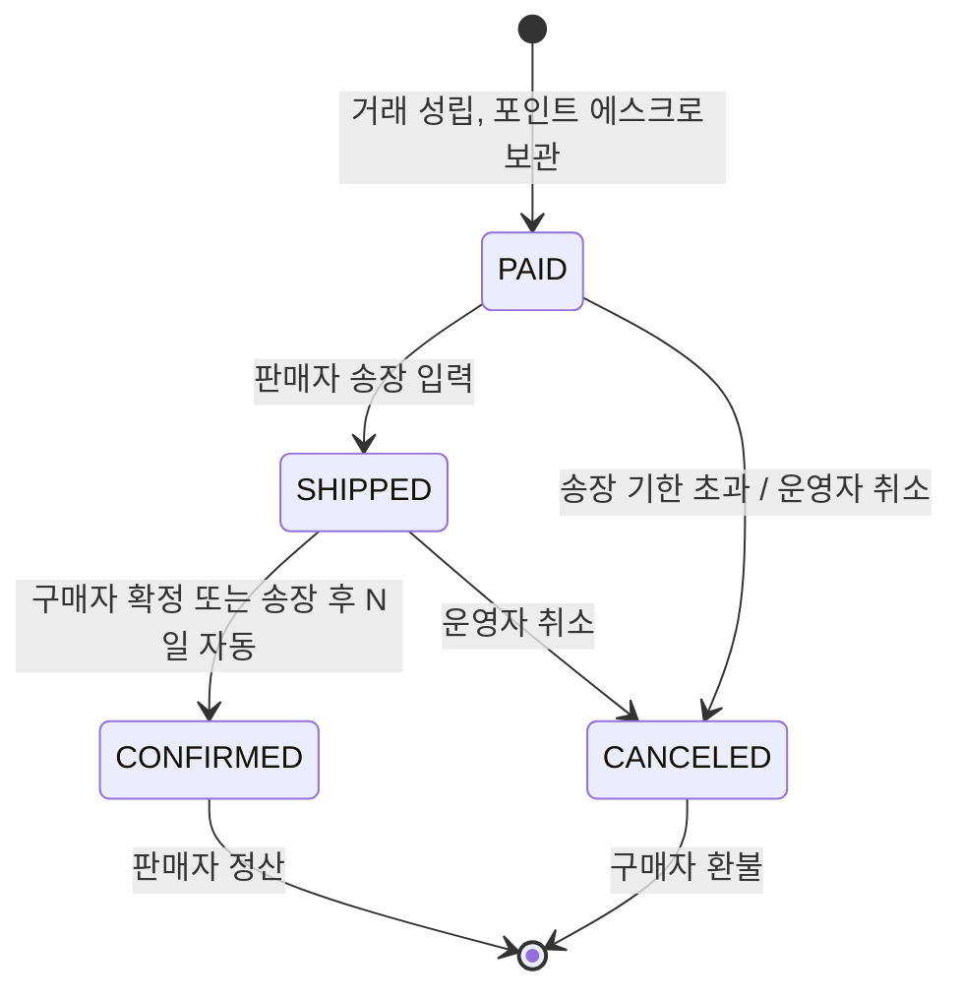

# 경매장 프로젝트 기술서 (5팀)

> 작성일: 2026-11-23 · 기준 문서: 경매장 도메인 설계 (5팀) · 범위: 2주 MVP
> `TODO`로 표시된 항목은 팀에서 채워야 하는 부분입니다.

---

## 1. 프로젝트 개요

### 1.1 한 줄 소개

가상 포인트로 물건을 사고파는 **개인 간 경매 플랫폼**입니다. 입찰 시점에 포인트를 묶고(홀딩), 구매확정 후에 판매자에게 정산하는 **에스크로 구조**로 안전한 거래를 보장합니다.

### 1.2 기획 배경

- 개인 간 중고 거래는 가격을 판매자가 정하기 때문에 적정 가격을 알기 어렵습니다.
- 경매 방식은 수요에 따라 가격이 정해지지만, 낙찰자가 돈을 내지 않거나 판매자가 물건을 보내지 않는 문제가 생깁니다.
- 이 프로젝트는 **입찰 시점 포인트 홀딩**과 **구매확정 후 정산**, **송장 기한 자동취소**로 이 문제들을 해결합니다.

### 1.3 프로젝트 정보

| 항목 | 내용 |
| --- | --- |
| 팀 | 5팀 (5명) |
| 기간 | 2주 (`TODO`: 시작일 ~ 종료일) |
| 형태 | 백엔드 중심 웹 서비스 |
| 저장소 | `TODO` |

### 1.4 팀 구성과 역할

| 이름 | 담당 | 범위 | 난이도 |
| --- | --- | --- | --- |
| `TODO` (팀장) | 입찰 | 입찰, 즉시구매, 동시성 제어, 포인트 홀딩 연동, 마감 연장 | 높음 |
| `TODO` | 포인트·정산 | 충전, 변동내역, 홀딩/해제/차감/정산 서비스(입찰·거래가 사용), 수수료 계산 | 높음 |
| `TODO` | 경매 | 경매 등록·조회·수정·취소, 경매 종료 스케줄러, 카테고리 | 중간 |
| `TODO` | 거래 | 송장, 구매확정, 송장 기한 자동취소·자동 구매확정 스케줄러, 운영자 취소 | 중간 |
| `TODO` | 회원·공통·알림 | 회원·인증, 예외 처리, 응답 포맷, Swagger, 알림(이벤트 수신), 테스트 데이터 | 중간 |

> 모듈 간 인터페이스(포인트 서비스, 거래 생성, 이벤트, 에러코드)는 `모듈_계약서.md`에서 합의합니다.

---

## 2. 목표

### 2.1 기능 목표

1. 판매자가 경매를 등록하고, 구매자가 입찰하거나 즉시구매할 수 있다.
2. 입찰 시점에 포인트를 묶어, 낙찰자가 결제하지 못하는 상황을 원천 차단한다.
3. 마감 직전 입찰 시 마감 시간이 자동으로 연장되어 막판 입찰(스나이핑)을 막는다.
4. 구매확정 전까지 플랫폼이 포인트를 보관하고, 확정 후 수수료를 떼고 판매자에게 정산한다.
5. 판매자가 송장을 기한 안에 입력하지 않으면 거래를 자동 취소하고 구매자에게 환불한다.

### 2.2 기술 목표

1. **동시성 제어**: 같은 경매에 동시에 입찰이 들어와도 현재가와 포인트가 어긋나지 않는다.
2. **돈의 정합성**: 모든 포인트 변동을 내역으로 남겨, 유저 잔액이 항상 내역과 일치한다.
3. **시간 기반 처리**: 경매 종료, 송장 기한 초과, 자동 구매확정을 스케줄러로 정확히 처리한다.
4. **값 스냅샷**: 설정값이나 주소가 바뀌어도 진행 중인 경매와 이미 성립한 거래의 조건은 바뀌지 않는다.

---

## 3. 기술 스택

> 팀에서 확정 후 수정하세요. 아래는 도메인 특성(트랜잭션, 락, 스케줄러)에 맞춘 제안입니다.

| 구분 | 기술 | 선택 이유 |
| --- | --- | --- |
| Language | Java 21 | `TODO` |
| Framework | Spring Boot 3.x | 트랜잭션·스케줄러·이벤트·보안 기능 기본 제공 |
| ORM | Spring Data JPA | `@Version` 낙관적 락, 비관적 락, `@Embeddable` 지원 |
| DB | MySQL 8 | 트랜잭션, 행 단위 락 |
| 설정 | `application.yml` + `@ConfigurationProperties` | 정책 값(수수료, 입찰 단위, 연장, 기한) 관리 |
| Auth | Spring Security + JWT | `TODO` |
| Test | JUnit 5, Testcontainers | 동시성 테스트를 실제 DB로 검증 |
| Docs | Swagger (springdoc) | API 명세 자동화 |
| Infra | Docker, `TODO` | `TODO` |
| 협업 | GitHub, Notion, Slack | `TODO` |

---

## 4. 핵심 정책 요약

| 항목 | 결정 |
| --- | --- |
| 결제 수단 | 가상 포인트. 충전은 테스트용 API(1회 최대 100만 원), 출금 없음 |
| 포인트 처리 | 입찰 시 최고 입찰자의 포인트를 홀딩. 상위 입찰이 오면 이전 홀딩 즉시 해제 |
| 즉시구매 | 즉시구매가 이상 입찰 또는 즉시구매 버튼 → 즉시 낙찰, 즉시구매가로 결제 |
| 입찰 단위 | 설정 파일의 가격 구간별 최소 입찰 단위 |
| 마감 연장 | 설정 파일의 감지 구간·연장 시간. 등록 시점 값을 경매에 고정 |
| 입찰자 공개 | 비공개. 입찰 내역은 금액과 시각만 노출 |
| 배송지 | 유저당 기본 배송지 1개. 거래 성립 시 거래에 복사 |
| 송장 기한 | 거래 성립 후 3일. 초과 시 자동 취소·환불 |
| 정산 | 구매확정(직접 또는 송장 입력 후 N일 자동) 시 수수료 차감 후 판매자에게 지급 |
| 수수료 | 판매자 부담, 금액 구간별 정률, 원 단위 미만 버림 |
| 정책 관리 | DB가 아닌 `application.yml`. 바꾸려면 재배포 |

---

## 5. 도메인 설계

### 5.1 ERD



### 5.2 엔티티 (8개)

모든 엔티티는 공통으로 `createdAt`, `updatedAt`을 갖습니다(BaseEntity). 금액은 모두 포인트 단위 `long`입니다.

| 엔티티 | 역할 | 주요 필드 |
| --- | --- | --- |
| User | 회원 | email, nickname, password, phone, role, availableBalance, lockedBalance, address(임베디드) |
| Auction | 경매 | seller, category, title, description, startPrice, buyNowPrice, currentPrice, highestBidder, bidCount, status, startAt, endAt, originalEndAt, extendTriggerMinutes, extendMinutes, extendCount, version |
| AuctionImage | 경매 이미지 | auction, url(문자열), sortOrder |
| Bid | 입찰 | auction, bidder, amount, bidAt |
| Trade | 거래 | auction, buyer, seller, type, price, feeRate, feeAmount, settleAmount, status, shippingAddress(임베디드), trackingNumber, tradedAt, shipDeadlineAt, shippedAt, autoConfirmAt, confirmSoonNotified, confirmedAt, canceledAt, cancelReason |
| BalanceHistory | 포인트 변동 내역 | user, type, amount, availableAfter, lockedAfter, refType, refId |
| Category | 카테고리(단일 계층) | name |
| Notification | 알림 | user, type, message, refType, refId, readAt |

**Address (임베디드 값 타입)**: recipientName, recipientPhone, zipCode, address1, address2
User의 기본 배송지와 Trade의 배송지 스냅샷에 같이 씁니다.

### 5.3 정책 설정값

```yaml
auction:
  fee:                      # 수수료: 판매자 부담, 구간별 정률 (예시 값)
    tiers:
      - max-price: 99999
        rate: 0.05
      - max-price: null     # 그 이상 전부
        rate: 0.03
  bid-unit:                 # 현재가 구간별 최소 입찰 단위
    tiers:
      - max-price: 9999
        unit: 500
      - max-price: 99999
        unit: 1000
      - max-price: 999999
        unit: 5000
      - max-price: null
        unit: 10000
  extension:                # 마감 연장 (등록 시점 값을 경매에 복사)
    enabled: true
    trigger-minutes: 30
    extend-minutes: 60
  trade:
    ship-deadline-days: 3   # 송장 입력 기한
    auto-confirm-days: 7    # 송장 입력 후 자동 구매확정
  point:
    max-charge-amount: 1000000
```

### 5.4 주요 Enum

| Enum | 값 |
| --- | --- |
| User.role | USER, ADMIN |
| Auction.status | ACTIVE, SOLD, BOUGHT_NOW, FAILED, CANCELED |
| Trade.type | BID_WIN, BUY_NOW |
| Trade.status | PAID, SHIPPED, CONFIRMED, CANCELED |
| Trade.cancelReason | SHIP_TIMEOUT, ADMIN |
| BalanceHistory.type | CHARGE, BID_LOCK, BID_UNLOCK, PURCHASE, REFUND, SETTLE |
| Notification.type | OUTBID, AUCTION_WON, AUCTION_SOLD, AUCTION_FAILED, SHIPPED, CONFIRM_SOON, TRADE_CANCELED, AUCTION_CANCELED |

### 5.5 상태 흐름

**경매**



**거래** (SOLD, BOUGHT_NOW일 때만 생성)



---

## 6. 주요 기능

### 6.1 회원

- 회원가입(이메일·닉네임 중복은 가입 시 검증), 로그인(JWT)
- 내 정보 조회·수정(닉네임, 연락처, 기본 배송지)
- 포인트 충전(테스트용), 포인트 변동 내역 조회

### 6.2 경매

- 경매 등록(이미지 URL 1~10개, 기간 1~14일)
- 경매 수정·취소(입찰 0건일 때만)
- 경매 목록(카테고리, 상태, 정렬), 상세 조회, 내 판매 경매 목록

### 6.3 입찰

- 입찰, 즉시구매, 마감 연장
- 입찰 내역(금액과 시각만, 본인 입찰 표시), 내 입찰 목록

### 6.4 거래

- 내 구매·판매 거래 목록과 상세(거래 상대 연락처 공개)
- 송장 입력, 구매확정
- 송장 기한 초과 자동취소, 자동 구매확정

### 6.5 알림

- 서비스 내 알림함: 상위 입찰 발생, 낙찰·판매·유찰, 송장 입력, 자동 확정 하루 전, 거래취소, 운영자 경매 강제 취소
- 알림 읽음 처리

### 6.6 운영자

- 경매 강제 취소, 거래 취소·환불(구매확정 전)
- 경매의 실제 입찰자 조회
- 카테고리 등록·수정·삭제(경매가 있으면 삭제 불가)

---

## 7. 비즈니스 규칙

규칙 번호(R-xx)는 코드, 테스트, PR에서 그대로 참조합니다. 범위에서 빠진 번호는 비워둡니다.

### 경매 등록·수정·취소

| 번호 | 규칙 |
| --- | --- |
| R-01 | 등록 즉시 시작한다. 예약 시작은 없다. |
| R-02 | 경매 기간은 1일 ~ 14일이다. |
| R-03 | 즉시구매가는 선택이다. 입력하면 시작가보다 커야 하고, 비우면 즉시구매가 불가하다. |
| R-04 | 최저 낙찰가는 없다. 시작가가 그 역할을 한다. |
| R-05 | 등록 시점의 연장 설정값을 경매에 복사해 고정한다. |
| R-06 | 판매자는 입찰이 0건일 때만 경매를 수정·취소할 수 있다. |
| R-07 | 유찰된 경매는 자동 재등록하지 않는다. |
| R-08 | 시작가와 즉시구매가는 100원 단위, 최소 1,000원이다. |
| R-09 | 이미지는 최소 1장, 최대 10장이다. 파일 업로드 없이 이미지 URL 문자열만 받는다. |

### 입찰

| 번호 | 규칙 |
| --- | --- |
| R-10 | 판매자는 자기 경매에 입찰할 수 없다. |
| R-11 | 현재 최고 입찰자는 다시 입찰할 수 없다. 즉시구매도 입찰로 보므로 할 수 없다. |
| R-12 | 첫 입찰은 시작가 이상, 이후 입찰은 현재가 + 최소 입찰 단위 이상이다. |
| R-13 | 최소 입찰 단위는 현재가가 속한 bid-unit 설정 구간으로 정한다. |
| R-14 | 사용 가능 포인트가 입찰가보다 적으면 거절한다. |
| R-15 | 입찰은 취소할 수 없다. |
| R-16 | 동시 입찰은 경매의 version으로 하나만 성공시킨다. 충돌한 요청은 재시도 없이 409(BID_CONFLICT)로 응답한다. |
| R-17 | 마감 일시(endAt)가 지난 입찰은 경매 상태와 관계없이 거절한다. |
| R-18 | 입찰 내역은 금액과 시각만 공개한다. 실제 입찰자는 운영자만 볼 수 있다. |
| R-19 | 기본 배송지를 등록한 유저만 입찰할 수 있다. |

### 포인트

| 번호 | 규칙 |
| --- | --- |
| R-20 | 입찰이 성공하면 입찰가만큼 사용 가능 → 묶인 포인트로 옮긴다(BID_LOCK). |
| R-21 | 같은 트랜잭션에서 이전 최고 입찰자의 홀딩을 해제한다(BID_UNLOCK). |
| R-22 | 포인트가 바뀔 때마다 보유금변동내역을 남긴다. |
| R-23 | 충전은 테스트용 충전 API로만 하고, 1회 최대 100만 원이다. 출금은 없다. |

### 마감 연장

| 번호 | 규칙 |
| --- | --- |
| R-30 | 마감 extendTriggerMinutes 이내에 입찰이 성공하면 마감을 "입찰 시각 + extendMinutes"로 갱신한다. |
| R-31 | 연장 횟수 상한은 없다. 입찰가가 최소 단위씩 오르고 포인트는 유한하므로 결국 끝난다. |

### 낙찰·즉시구매·유찰

| 번호 | 규칙 |
| --- | --- |
| R-40 | 입찰가가 즉시구매가 이상이면 즉시 낙찰한다. 결제 금액은 즉시구매가다. |
| R-41 | 마감이 지나면 스케줄러가 종료 처리한다. 입찰이 있으면 SOLD, 없으면 FAILED다. |
| R-42 | 낙찰·즉시구매가 되면 거래를 만들고, 구매자 포인트는 에스크로 보관 상태로 남는다. |
| R-43 | 입찰가가 즉시구매가 이상이면 처음부터 즉시구매가만큼만 묶는다. 입찰 내역에도 즉시구매가로 기록한다. |
| R-44 | 즉시구매 버튼은 즉시구매가로 입찰한 것과 똑같이 처리한다. |
| R-45 | 입찰이 있어도 현재가가 즉시구매가보다 낮으면 즉시구매할 수 있다. |

### 거래·정산

| 번호 | 규칙 |
| --- | --- |
| R-50 | 거래가 성립하면 구매자와 판매자가 서로의 연락처를 볼 수 있다. |
| R-51 | 판매자가 송장번호를 입력한다. |
| R-52 | 구매확정은 구매자가 하거나, 송장 입력 + auto-confirm-days가 지나면 자동으로 된다. |
| R-53 | 구매확정 시 구매자의 묶인 포인트를 차감하고(PURCHASE), 판매자에게 정산금을 지급한다(SETTLE). |
| R-54 | 수수료는 판매자 부담, fee 설정 구간의 정률을 거래 성립 시점에 스냅샷한다. 원 단위 미만은 버린다. |
| R-55 | 구매확정 전에는 운영자가 거래를 취소할 수 있고, 구매자에게 환불한다(REFUND). |
| R-56 | 거래 성립 후 ship-deadline-days(3일)까지 송장이 없으면 자동 취소하고 환불한다(SHIP_TIMEOUT). |
| R-57 | 거래 성립 시 구매자의 기본 배송지를 거래에 복사한다. 거래 중 배송지 변경은 없다. |
| R-58 | 송장 기한 초과로 자동 취소돼도 판매자에게 불이익은 없다. |

### 회원·운영

| 번호 | 규칙 |
| --- | --- |
| R-61 | 운영자는 진행 중 경매를 강제 취소할 수 있다. 최고 입찰자의 홀딩은 자동으로 풀리고, 판매자와 최고 입찰자에게 AUCTION_CANCELED 알림을 보낸다. |
| R-62 | 정책 값은 설정 파일(application.yml)로 관리한다. 운영자는 카테고리를 등록·수정·삭제할 수 있다. |
| R-63 | 알림은 서비스 내 알림함으로만 보낸다. |
| R-64 | 카테고리는 단일 계층이다. 경매가 하나라도 달린 카테고리는 삭제할 수 없다. |
| R-65 | 배송지는 유저당 기본 배송지 1개만 두고, 내 정보 수정에서 바꾼다. |
| R-66 | 묶인 포인트가 있으면 배송지를 비울 수 없다. |

---

## 8. API 설계 (29개)

> 상세 요청·응답은 Swagger로 관리합니다.

### 회원·인증 (6)

| Method | URI | 설명 | 권한 |
| --- | --- | --- | --- |
| POST | `/api/auth/signup` | 회원가입 | 전체 |
| POST | `/api/auth/login` | 로그인 | 전체 |
| GET | `/api/users/me` | 내 정보 조회 | USER |
| PATCH | `/api/users/me` | 내 정보 수정(닉네임, 연락처, 기본 배송지) | USER |
| POST | `/api/users/me/charge` | 포인트 충전(테스트용) | USER |
| GET | `/api/users/me/balance-histories` | 포인트 변동 내역 | USER |

### 카테고리 (4)

| Method | URI | 설명 | 권한 |
| --- | --- | --- | --- |
| GET | `/api/categories` | 카테고리 목록 | 전체 |
| POST | `/api/admin/categories` | 카테고리 등록 | ADMIN |
| PATCH | `/api/admin/categories/{id}` | 카테고리 수정 | ADMIN |
| DELETE | `/api/admin/categories/{id}` | 카테고리 삭제(경매 없을 때만) | ADMIN |

### 경매 (6)

| Method | URI | 설명 | 권한 |
| --- | --- | --- | --- |
| POST | `/api/auctions` | 경매 등록 | USER |
| GET | `/api/auctions` | 경매 목록(카테고리, 상태, 정렬) | 전체 |
| GET | `/api/auctions/{id}` | 경매 상세 | 전체 |
| PATCH | `/api/auctions/{id}` | 경매 수정(입찰 0건) | 판매자 |
| POST | `/api/auctions/{id}/cancel` | 경매 취소(입찰 0건) | 판매자 |
| GET | `/api/users/me/auctions` | 내 판매 경매 목록 | USER |

### 입찰 (4)

| Method | URI | 설명 | 권한 |
| --- | --- | --- | --- |
| POST | `/api/auctions/{id}/bids` | 입찰 | USER |
| POST | `/api/auctions/{id}/buy-now` | 즉시구매 | USER |
| GET | `/api/auctions/{id}/bids` | 입찰 내역(금액·시각만) | 전체 |
| GET | `/api/users/me/bids` | 내 입찰 목록 | USER |

### 거래 (4)

| Method | URI | 설명 | 권한 |
| --- | --- | --- | --- |
| GET | `/api/trades?role=buyer\|seller` | 내 거래 목록 | USER |
| GET | `/api/trades/{id}` | 거래 상세(상대 연락처 포함) | 거래 당사자 |
| PATCH | `/api/trades/{id}/tracking` | 송장 입력 | 판매자 |
| POST | `/api/trades/{id}/confirm` | 구매확정 | 구매자 |

### 알림 (2)

| Method | URI | 설명 | 권한 |
| --- | --- | --- | --- |
| GET | `/api/notifications` | 알림 목록 | USER |
| PATCH | `/api/notifications/{id}/read` | 읽음 처리 | USER |

### 운영자 (3)

| Method | URI | 설명 | 권한 |
| --- | --- | --- | --- |
| POST | `/api/admin/auctions/{id}/cancel` | 경매 강제 취소 | ADMIN |
| GET | `/api/admin/auctions/{id}/bids` | 실제 입찰자 포함 입찰 내역 | ADMIN |
| POST | `/api/admin/trades/{id}/cancel` | 거래 취소·환불 | ADMIN |

---

## 9. 핵심 기술 과제와 해결 전략

### 9.1 입찰 동시성

**문제**: 같은 경매에 두 사람이 동시에 입찰하면 둘 다 "현재가보다 높다"는 검증을 통과해, 현재가와 홀딩이 어긋날 수 있습니다.

**전략**

- 경매에 `@Version`(낙관적 락)을 두고, 충돌한 입찰은 BID_CONFLICT(409)로 응답하고, 클라이언트가 최신 현재가를 보고 다시 입찰합니다(R-16).
- 포인트 변경은 유저 행에 비관적 락(`SELECT ... FOR UPDATE`)을 걸거나 조건부 UPDATE(`available >= amount`)로 처리합니다.
- 데드락을 막기 위해 락 순서를 **경매 → 유저(id 오름차순)**로 고정합니다.
- Testcontainers로 동시 입찰 100건 테스트를 작성해 검증합니다.

**입찰 트랜잭션 순서**

1. 경매 조회 → 상태 ACTIVE, `now < endAt` 확인(R-17)
2. 판매자 본인·현재 최고 입찰자 여부, 기본 배송지 등록 여부 확인(R-10, R-11, R-19)
3. 최소 입찰가 계산(R-12, R-13). 입찰가가 즉시구매가 이상이면 처리 금액을 즉시구매가로 바꿈(R-43)
4. 입찰자 포인트 홀딩(R-20), 이전 최고 입찰자 홀딩 해제(R-21), 변동 내역 기록(R-22)
5. 경매 현재가·최고 입찰자·입찰 수 갱신, 마감 연장 판단(R-30)
6. 즉시구매가에 도달했으면 낙찰 처리 후 거래 생성(R-40, R-42)
7. 커밋. version 충돌 시 재시도 없이 BID_CONFLICT(409) 응답
8. 커밋 후 이전 최고 입찰자에게 OUTBID 알림 이벤트 발행

### 9.2 포인트 정합성

- 유저 잔액(`availableBalance`, `lockedBalance`)과 별도로 모든 변동을 `BalanceHistory`에 남깁니다.
- 각 내역에 변동 후 잔액을 기록해, 잔액이 어긋났을 때 시점을 추적할 수 있습니다.
- 포인트 변경은 **포인트 서비스 한 곳**에서만 합니다. 다른 도메인은 이 서비스의 메서드(`lockForBid`, `unlockBid`, `confirmPurchase`, `refund`)만 호출합니다. 시그니처와 약속은 `모듈_계약서.md`에 있습니다.

### 9.3 시간 기반 처리 (스케줄러 4개)

| 작업 | 주기(제안) | 대상 | 처리 |
| --- | --- | --- | --- |
| 경매 종료 | 1분 | ACTIVE이면서 endAt 지남 | SOLD(거래 생성) 또는 FAILED |
| 송장 기한 초과 | 10분 | PAID이면서 shipDeadlineAt 지남 | CANCELED(SHIP_TIMEOUT), 환불 |
| 자동 구매확정 | 10분 | SHIPPED이면서 autoConfirmAt 지남 | CONFIRMED, 정산 |
| 확정 임박 알림 | 1시간 | SHIPPED, autoConfirmAt까지 24시간 이내, confirmSoonNotified = false | CONFIRM_SOON 알림, confirmSoonNotified = true |

- 스케줄러가 늦게 돌아도 R-17로 마감 이후 입찰은 받지 않으므로 결과가 바뀌지 않습니다.
- 서버를 여러 대 띄울 경우 ShedLock 등으로 중복 실행을 막습니다(`TODO`: 배포 구조 확정 후 결정).

### 9.4 알림

- 각 도메인은 알림을 직접 만들지 않고 **이벤트만 발행**합니다(예: `BidPlacedEvent`, `TradeCanceledEvent`).
- 알림 담당은 `@TransactionalEventListener(phase = AFTER_COMMIT)`로 받아 알림을 저장합니다.
- 이렇게 하면 알림 저장에 실패해도 입찰·거래 트랜잭션은 롤백되지 않고, 담당자 간 코드 충돌도 줄어듭니다.

### 9.5 값 스냅샷

| 값 | 복사 시점 | 저장 위치 |
| --- | --- | --- |
| 마감 연장 설정 | 경매 등록 시 | Auction.extendTriggerMinutes, extendMinutes |
| 수수료율 | 거래 성립 시 | Trade.feeRate, feeAmount, settleAmount |
| 배송지 | 거래 성립 시 | Trade.shippingAddress |
| 입찰 단위 | 복사 안 함 | 설정값을 매번 조회 |

---

## 10. 범위와 심화 과제

| 항목 | 구분 | 비고 |
| --- | --- | --- |
| 운영자 정책 관리 API | 심화 | 지금은 application.yml 설정값 |
| 자동 입찰(대리 입찰) | 심화 | 최대 금액을 정해두면 시스템이 최소 단위로 대신 입찰 |
| 실시간 현재가 갱신·푸시 알림 | 심화 | WebSocket / SSE. 지금은 알림함만 |
| 배송지 여러 개 관리 | 심화 | 지금은 기본 배송지 1개 |
| 이미지 파일 업로드 | 심화 | 지금은 URL 문자열 |
| 카테고리 계층 | 심화 | 지금은 단일 계층 |
| 회원 탈퇴 | 심화 | |
| 판매자 경매 등록 상한 | 심화 | |
| 토큰 재발급·중복 확인 API | 심화 | 중복은 가입 시 검증 |
| 판매자 신뢰도·제재, 유저 정지 | 심화 | 경매·거래 강제 취소만 제공 |
| 채팅 | 범위 밖 | 거래 상대 연락처 공개로 대체 |
| 신고·분쟁 처리 | 범위 밖 | 운영자 거래 취소로 대체 |
| 실제 결제(PG)·출금 | 범위 밖 | 가상 포인트만 사용 |
| 예약 시작 | 범위 밖 | 등록 즉시 시작 |

---

## 11. 일정 (2주)

> `TODO`: 실제 날짜를 채웁니다.

| 기간 | 할 일 | 완료 기준 |
| --- | --- | --- |
| 1~2일차 | 엔티티·ERD 확정, 프로젝트·공통 세팅(예외, 응답, Swagger), **포인트 서비스 인터페이스 합의**, 컨벤션 | 빈 API가 Swagger에 뜸 |
| 3~5일차 | 회원·인증, 경매 등록·조회, 포인트 충전·홀딩, 입찰 기본 흐름 | 가입 → 충전 → 등록 → 입찰이 됨 |
| 6~7일차 | 즉시구매, 마감 연장, 경매 종료 스케줄러, 거래 생성·송장·구매확정, 알림 | 낙찰 → 구매확정 → 정산이 됨 |
| 8~9일차 | 송장 기한·자동확정 스케줄러, 운영자 기능, 동시 입찰 테스트, 통합 버그 수정 | 전체 시나리오 통과 |
| 10일차 | 배포, README·문서 정리, 발표 준비 | 시연 가능 |

---

## 12. 협업 규칙

> `TODO`: 팀에서 정한 내용으로 채웁니다.

- **브랜치 전략**: `TODO` (예: `main` / `develop` / `feature/{이슈번호}-{기능}`)
- **커밋 컨벤션**: `TODO` (예: `feat:`, `fix:`, `refactor:`, `test:`, `docs:`)
- **PR 규칙**: `TODO` (예: 리뷰어 1명 이상 승인 후 머지, 관련 규칙 번호 R-xx 명시)
- **회의**: `TODO` (예: 매일 10시 스탠드업 15분)
